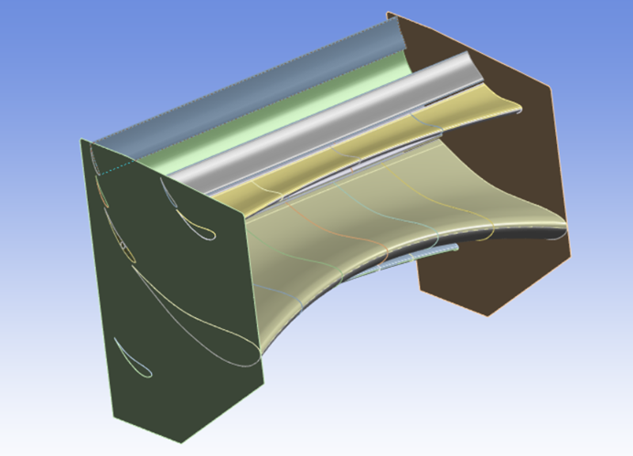
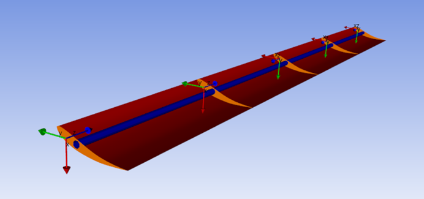
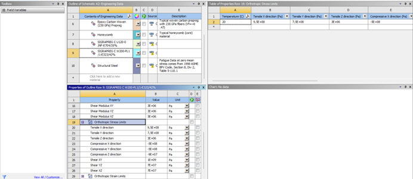
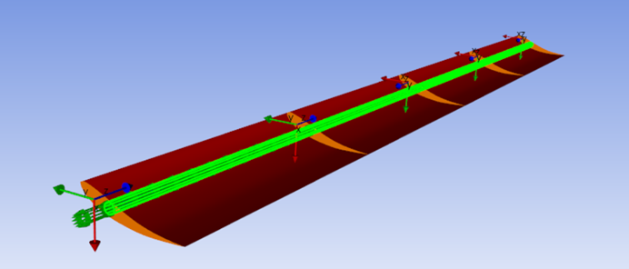
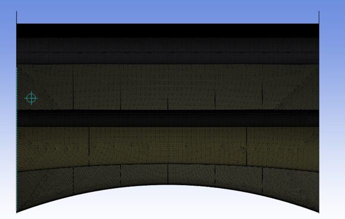
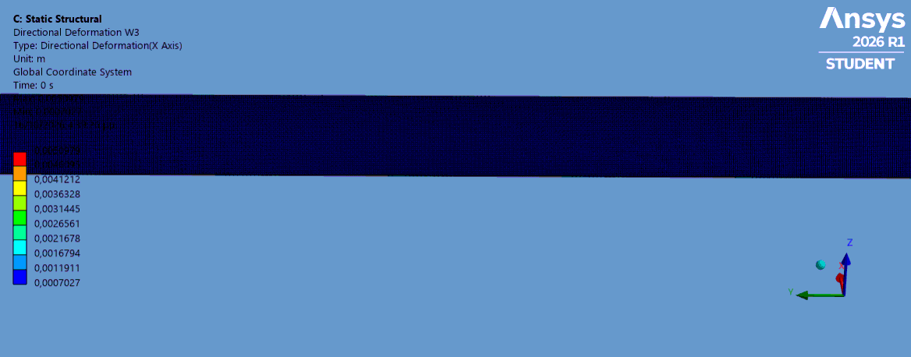

# Formula Student Rear Wing — Composite Structural Design & FEM Analysis

**WOB Racing | Ostfalia University of Applied Sciences | Germany**

Structural design and finite element analysis of a carbon-fiber composite rear wing developed for the Formula Student race car of **WOB Racing**, the student racing team of **Ostfalia University of Applied Sciences**.

As a member of the team's Chassis & Aerodynamics department, I was responsible for designing the internal structural components, defining the composite materials and layups, and evaluating the rear wing's structural response using ANSYS.

*Complete rear wing assembly developed for WOB Racing.*

## Project Overview

This project focuses on the structural development of a multi-element rear wing, combining composite material definition, CAD modeling, laminate design, and finite element analysis (FEA).

The external aerodynamic geometry was developed by the team's aerodynamics department. My responsibility was to design the internal structural configuration of the wing elements, define their composite materials and layups, and evaluate the structural behavior of the complete rear wing assembly under aerodynamic loading.

The primary objective was to achieve a lightweight, sufficiently stiff structure that could withstand the expected aerodynamic loads while limiting deformation and preserving the intended aerodynamic geometry.

## Tools & Technologies

- **CATIA / 3DEXPERIENCE** — CAD modeling and internal structural design
- **ANSYS Engineering Data** — Composite material definition using supplier-provided properties
- **ANSYS ACP (Pre)** — Composite layup definition, ply thicknesses, stacking sequences, and fiber orientations
- **ANSYS Mechanical** — Static structural finite element analysis
- **ANSYS Workbench** — Integration of composite models into the complete assembly

## 1. Structural Design

The rear wing consists of seven aerodynamic elements (W1–W7) and two endplates.

The external aerodynamic surfaces were provided by the aerodynamics department. Each wing element was then treated individually to develop its internal structure and composite configuration.

My work included:

- Designing internal supporting structures within the aerodynamic profiles.
- Defining the composite construction of the outer skins and internal components.
- Investigating different internal structural configurations.
- Adjusting ply arrangements and fiber orientations to improve stiffness while controlling mass.
- Preparing the individual wing elements for integration into the complete structural assembly.

*Internal supporting structures developed for the composite wing elements.*

### Design Development

The initial structural concept included internal supporting panels and a longitudinal tubular reinforcement.

Through iterative CAD development and FEM evaluation, the configuration was refined. Tubular reinforcement was removed from most elements, while internal supports and composite layups were adjusted to achieve a more efficient structural design.

These decisions were guided by structural mechanics principles, particularly bending stiffness, material distribution, and the influence of fiber orientation on composite behavior.

## 2. Composite Material Modeling

### Material Definition

I created the composite material definitions in **ANSYS Engineering Data**, using the mechanical properties provided by the team's material supplier.

These material definitions were then used in ANSYS ACP (Pre) to develop the laminate configurations, including ply thicknesses, stacking sequences, and fiber orientations for the outer skins and internal structural components.

*Composite material definitions in ANSYS Engineering Data using supplier-provided mechanical properties.*

### Composite Layup Design

The available material options included woven carbon fiber, unidirectional (UD) carbon fiber, and honeycomb core material.

The outer surface ply was required to use woven carbon fiber to maintain consistency with the team's composite construction approach.

The composite design process involved:

- Defining material assignments for individual structural components.
- Selecting ply thicknesses and stacking sequences.
- Specifying fiber orientations.
- Configuring the composite skins and internal supporting structures.
- Transferring the composite definitions into ANSYS Mechanical for structural evaluation.

Each wing element was prepared individually before integration into the complete rear wing assembly.

*Composite layup configuration, stacking sequence, and fiber orientations in ANSYS ACP (Pre).*

## 3. Finite Element Model

A static structural model of the complete rear wing was developed in **ANSYS Mechanical**.

The individual composite components were assembled in their original positions, with contact definitions used to represent the connections between skins, internal structures, and adjacent components.

The model included bonded connections between relevant structural components and fixed supports at the rear wing mounting regions.

### Mesh and Solver

The ANSYS solver output recorded the following model statistics:

| Parameter | Value |
|---|---:|
| Analysis type | Static Structural |
| Nodes | 332,105 |
| Initial generated elements | 1,325,252 |
| Structural element formulation | Including SHELL181 |
| Composite modeling | Layered shell sections from ANSYS ACP |

The reported element count includes contact elements and should not be interpreted as the number of structural mesh elements alone.

*Finite element mesh of the complete rear wing structural assembly.*

## 4. Aerodynamic Loading

Aerodynamic loads were provided by the team's aerodynamics department based on CFD simulations, representing the **worst-case aerodynamic loading conditions** considered for the structural analysis.

These forces were transferred to the structural model and applied at the corresponding locations of the rear wing assembly.

Six active force definitions were used in the final static structural analysis.

| Load | X Component | Y Component | Z Component |
|---|---:|---:|---:|
| Force 1 | +52 N | 0 N | 0 N |
| Force 2 | 0 N | 0 N | −46 N |
| Force 3 | 0 N | 0 N | −26 N |
| Force 4 | +88 N | 0 N | 0 N |
| Force 5 | +100 N | 0 N | 0 N |
| Force 6 | 0 N | 0 N | −50 N |

The loads were applied using the *Surface Effect* method in ANSYS Mechanical.

This approach allowed the structural design to be evaluated against aerodynamic loading conditions obtained from the team's CFD work, rather than relying on arbitrarily selected structural forces.

## 5. Structural Analysis Results

The static structural simulation was used to evaluate the deformation of the complete rear wing assembly and identify regions with comparatively high displacement.

### Total Deformation

**Maximum total deformation: 5.488 mm**

The total deformation result represents the maximum displacement magnitude in the rear wing assembly under the applied aerodynamic load case.

*Animated deformation of wing element W3, which exhibited the highest reported directional displacement under CFD-derived aerodynamic loading.*

### Directional Deformation

Directional deformation results were also evaluated for the individual wing elements.

| Wing Element | Maximum Reported Directional Deformation |
|---|---:|
| W1 | 0.054 mm |
| W2 | 0.692 mm |
| W3 | 5.098 mm |
| W4 | 3.834 mm |
| W5 | 0.846 mm |
| W6 | 0.321 mm |
| W7 | 1.277 mm |

These values represent the maximum reported directional displacement for each result definition, not the total deformation magnitude of each individual wing element. The directional axes must be checked in the original result settings before making direct comparisons.

The results helped assess the structural response of the different elements and supported decisions regarding internal reinforcement and composite configuration.

### Weight Reduction

Through iterative structural design and composite layup refinement,
the rear wing mass was reduced by approximately **1.5 kg**
compared to the initial design configuration.

## 6. Design Considerations

The main engineering challenge was balancing three competing objectives:

**Structural stiffness:** Limiting wing deformation under aerodynamic loading to maintain the intended aerodynamic shape.

**Low mass:** Avoiding unnecessary reinforcement and excessive composite material.

**Manufacturability:** Developing internal structures and composite configurations compatible with the team's intended manufacturing approach.

The design was developed iteratively through changes to internal geometry and composite layups, using finite element results to guide structural refinement.

## 7. Formula Student Design Requirements

The project was developed with consideration of the Formula Student structural requirements for aerodynamic devices, including a specified load and maximum allowable deflection.

The team's design reference included a **200 N load applied over an area of at least 225 cm²**, with a **10 mm maximum deflection limit**.

The CFD-derived aerodynamic loading case documented above is distinct from that prescribed regulatory load case. Therefore, the reported 5.488 mm maximum deformation should not be treated, by itself, as verification of compliance with the Formula Student rule.

## 8. My Responsibilities

As a member of WOB Racing's Chassis & Aerodynamics department, my contributions to this project included:

- Structural CAD design of the internal components of the rear wing.
- Creation of composite material definitions in ANSYS Engineering Data using supplier-provided mechanical properties.
- Composite layup development for the aerodynamic elements and their internal structures.
- Selection and refinement of ply configurations and fiber orientations.
- Preparation and integration of individual composite models.
- Setup of the complete rear wing static structural analysis.
- Application of CFD-derived aerodynamic loads provided by the aerodynamics department.
- Evaluation of deformation results and FEM-guided structural refinement.

The external aerodynamic geometry and CFD load calculations were developed by other members of the team.

## 9. Project Documentation

The repository includes selected CAD views, composite modeling screenshots, finite element model visualizations, and deformation results.

These materials document the design methodology and final analysis rather than presenting a complete reproducible simulation package.

## Key Takeaways

This project provided practical experience in the structural development of composite aerodynamic components, including the definition of composite material properties, laminate design, CAD modeling, and finite element analysis.

It also involved collaboration between the aerodynamic and structural design activities of a Formula Student team, with CFD-derived loading conditions informing structural design decisions.